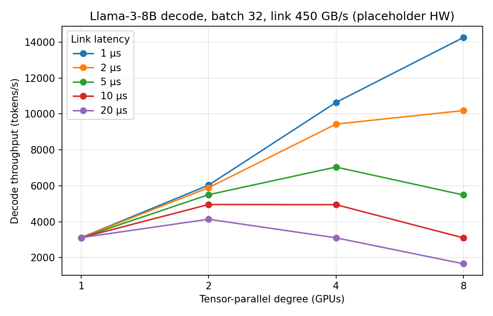

# LLM Inference Analytical Performance Model

A config-driven, roofline-style analytical model of LLM **prefill** and **decode**, with a
**tensor-parallel (TP) communication model** and what-if sweeps. The single-GPU part is calibrated
and validated against real measurements on an RTX 3050 Laptop GPU (TinyLlama-1.1B). The multi-GPU
part is purely analytical and runs on placeholder hardware.

> These are analytical estimates, not cycle-accurate simulation. Treat results as trends and
> bottleneck analysis, not exact latency predictions.

## What it models

- **Model specs:** layers, hidden size, heads, GQA KV heads, FFN size, vocab (Llama-3-8B, TinyLlama-1.1B).
- **Prefill:** compute vs memory time, including causal attention FLOPs.
- **Decode:** weight reads plus KV-cache reads, batching, quantization (`weight_bytes`, `kv_bytes`).
- **Roofline:** `time = max(compute_time, memory_time) + overhead`, with arithmetic intensity and bottleneck label.
- **Tensor parallelism:** weights and KV split N ways, plus 2 ring all-reduces per layer.
- **Calibration knobs:** `compute_eff`, `mem_eff`, `step_overhead_ms`.

## Project structure

```
.
├── configs/experiment.yaml     # models, hardware, run settings (single config)
├── src/
│   ├── specs.py                # ModelSpec, Hardware, YAML loading
│   ├── inference.py            # prefill, decode_step, decode_step_tp, fits
│   ├── comm.py                 # ring all-reduce cost model
│   ├── sweep.py                # single-GPU prefill/decode sweep
│   ├── tp_sweep.py             # TP degree x batch sweep
│   ├── whatif.py               # latency x bandwidth x TP sweep -> CSV
│   ├── plot_tp.py              # TP scaling plot
│   ├── gpu_benchmark.py        # measure GEMM TFLOP/s
│   ├── bandwidth_benchmark.py  # measure memory bandwidth
│   └── validate_tinyllama.py   # measure real prefill/decode with HF
└── results/                    # CSVs and plots
```

## Setup and run

```bash
python3 -m venv .venv && source .venv/bin/activate
pip install pyyaml matplotlib pytest
pip install transformers accelerate     # only for validation
# install a CUDA-enabled PyTorch build from pytorch.org

python src/sweep.py          # single-GPU model
python src/tp_sweep.py       # TP sweep (no GPU needed)
python src/whatif.py         # writes results/tp_whatif.csv
python src/plot_tp.py        # writes results/tp_scaling.png
```

Run everything from the project root. `tp_sweep.py`, `whatif.py` and `plot_tp.py` are pure Python
arithmetic and do not use the GPU.

## Part 1: Single-GPU calibration and validation (RTX 3050 Laptop, TinyLlama-1.1B)

**Measured inputs**

| Parameter | Value | How |
|---|---|---|
| Peak fp16 compute | 14.0 TFLOP/s | `gpu_benchmark.py --size 4096 --dtype fp16` (1024: 10.0, 2048: 11.8) |
| Memory bandwidth | 183.2 GB/s | `bandwidth_benchmark.py` |
| `compute_eff` | 0.85 | fitted to batch-1 prefill |
| `step_overhead_ms` | 3.7 | fitted to batch-1 decode |

**Results (fp16, 512-token prompt, 512 context)**

| Case | Model | Measured | Note |
|---|---|---|---|
| Prefill, batch 1 | 100.3 ms | 100.3 ms | calibration point |
| Decode step, batch 1 | 15.78 ms | 15.76 ms | calibration point |
| Decode step, batch 4 | 15.97 ms | 18.48 ms | held out, model ~14% fast |
| Decode step, batch 8 | ~16.2 ms | 20.84 ms | held out, model ~22% fast |
| Prefill, batch 4 | ~390 ms | 377.7 ms | held out, within ~6% |
| Prefill, batch 8 | ~777 ms | 503.2 ms | held out, model too pessimistic |

(Batch 4/8 model values marked `~` were estimated by scaling; rerun `prefill()` and `decode_step()` for exact figures.)

**Findings**

- Prefill is **compute-bound**; decode is **memory-bound** at small batch. Decode throughput scales almost linearly with batch until compute catches up (about batch 100+ on this GPU).
- Two fitted parameters match the calibration points by construction, so the held-out batches are the real test.
- Decode gap grows with batch (-14% at 4, -22% at 8). Likely unmodeled per-sequence costs in HF eager mode: GQA KV expansion, cache copies, elementwise ops, sampling.
- Prefill at larger batch is faster than modeled because GEMM efficiency rises with size (benchmark: 10, 11.8, 14 TFLOP/s). A fixed `compute_eff` cannot capture this. Next step: model efficiency as a function of GEMM size.

## Part 2: Tensor parallelism what-if (placeholder hardware)

Setup: Llama-3-8B, decode, batch 32, context 2048, fp16, 450 GB/s link, hypothetical 80 GB GPU
(400 TFLOP/s, 3000 GB/s: **placeholder values, not a real product**). The model assumes 2 ring
all-reduces per layer (64 per step) and no compute/communication overlap.



Approximate throughput read from the plot (tokens/s):

| Link latency | TP=1 | TP=2 | TP=4 | TP=8 | Best TP |
|---|---|---|---|---|---|
| 1 µs | ~3100 | ~6000 | ~10600 | ~14250 | 8 |
| 2 µs | ~3100 | ~5900 | ~9400 | ~10200 | 8 (flattening) |
| 5 µs | ~3100 | ~5500 | ~7050 | ~5500 | 4 |
| 10 µs | ~3100 | ~4950 | ~4950 | ~3100 | 2 to 4 |
| 20 µs | ~3100 | ~4150 | ~3100 | ~1650 | 2 |
    
**Findings**

- Per-GPU memory time halves each time TP doubles, but communication grows with TP degree.
- The all-reduce message is tiny at decode (batch x hidden x 2 bytes), so cost is dominated by the **latency term** `2(N-1) x latency` per all-reduce, not bandwidth.
- Throughput therefore **peaks and then falls**. The optimal TP degree drops as link latency rises: 8 at 1 µs, 4 at 5 µs, 2 at 20 µs.
- At 20 µs, TP=8 is slower than a single GPU.
- Larger batches amortize the fixed communication cost, so the optimal TP degree grows with batch size (see `tp_sweep.py`).

## Assumptions and limitations

- Hardware numbers for the multi-GPU part are placeholders. Replace them with public datasheet values and cite the source in the YAML before quoting any absolute figures.
- Conclusions are sensitive to `link_latency_us`; that is the point of the sweep.
- Ring all-reduce only; real NCCL may use tree or low-latency protocols for small messages.
- No compute/communication overlap, so communication cost is conservative.
- TP beyond the number of KV heads (8 for Llama-3-8B) needs KV replication, which is not modeled.
- Attention is simplified; no FlashAttention tiling, cache hierarchy, kernel-launch modeling beyond a fixed overhead, or quantization dequant overhead.
- Single-GPU validation covers one small model on one laptop GPU.